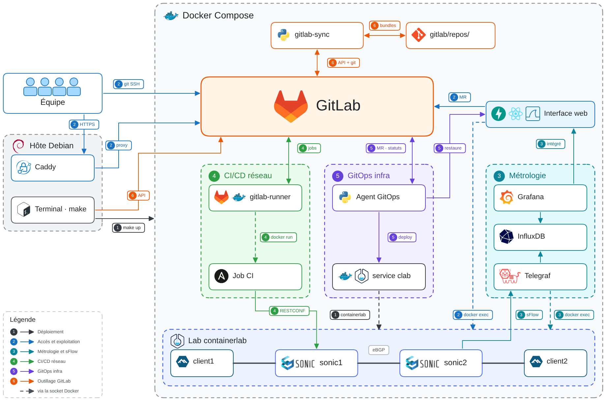

[![containerlab][clab-shield]][clab-url]
[![SONiC][sonic-shield]][sonic-url]
[![Alpine Linux][alpine-shield]][alpine-url]
[![Docker][docker-shield]][docker-url]
[![FastAPI][fastapi-shield]][fastapi-url]
[![React][react-shield]][react-url]
[![InfluxDB][influxdb-shield]][influxdb-url]
[![Grafana][grafana-shield]][grafana-url]
[![GitLab][gitlab-shield]][gitlab-url]
[![Ansible][ansible-shield]][ansible-url]


<a id="readme-top"></a>
<br />
<div align="center">
  

  <h3 align="center">ima-netw-automation-grp-3</h3>

  <p align="center">
    Notre solution d'automatisation des réseaux, avec IaC, Métrologie, Télémétrie et plus encore.
    <br />
    <a href="GUIDE.md"><strong>Lire le guide »</strong></a>
    <br />
    <br />
  </p>
</div>

<details>
  <summary>Sommaire</summary>
  <ol>
    <li><a href="#à-propos">À propos</a><ul><li><a href="#construit-avec">Construit avec</a></li></ul></li>
    <li><a href="#démarrage">Démarrage</a></li>
    <li><a href="#utilisation">Utilisation</a></li>
    <li><a href="#contributeurs">Contributeurs</a></li>
    <li><a href="#licence">Licence</a></li>
    <li><a href="#contact">Contact</a></li>
  </ol>
</details>

## À propos



Tout dans un `docker compose` : containerlab (clab) dans un conteneur, rien n'est à installer
sur l'hôte. Le lab distribué est à titre d'exemple, libre à vous de modifier la topologie et sa configuration selon le [GUIDE](GUIDE.md#1-vue-densemble).

Autour du lab :

- **Interface web** pour la vision des métriques, la télémétrie, modification des configurations comme pour un TP, et d'autre encore.
- **Métrologie** : Telegraf relève tous les nœuds sans agent, InfluxDB stocke les données, Grafana affiche. Latence, débit et flux sFlow par application.
- **GitLab** : sur le réseau de management du lab, les dépôts initiaux sont dans `gitlab/repos/` et sont sauvegardés.
- **CI/CD réseau** : un runner exécute des jobs Ansible qui valident, déploient, vérifient ou annulent les changements de configuration des équipements, par RESTCONF.
- **GitOps** : topologie dans un projet GitLab, chaque merge request reçoit son plan et ce qu'il va modifier sur la topologie, et sa fusion le déploie.

<p align="right">(<a href="#readme-top">retour en haut</a>)</p>

## Démarrage

Docker avec le plugin compose (sans `sudo`), `make`, `curl`, `openssl`,
environ 8 Go de RAM et 10 Go de disque libres.

```bash
git clone https://github.com/ima-netw-automation-grp-3/ima-netw-automation-grp-3.git
cd ima-netw-automation-grp-3
make init    # creation du .env
make image   # image SONiC
make up
```

| Service | Adresse |
|---|---|
| Interface web | <http://127.0.0.1:8080> |
| Grafana | <http://127.0.0.1:3000> |
| GitLab | <http://172.20.30.5> (compte `lab`, mot de passe dans `GITLAB_USERS` du `.env`) |

<p align="right">(<a href="#readme-top">retour en haut</a>)</p>

## Utilisation

```bash
make smoke          # vérifications du système
make ci-project     # crée le projet GitLab de CI/CD réseau (Ansible)
make infra-project  # place l'infra du lab dans GitLab (GitOps)
make traffic        # génère du trafic typé pour visualisation des flux
make stop / start   # arrête / redéploie le lab uniquement
make down           # arrête le lab et le système, données conservées
make help           # toutes les cibles
```

Pour modifier de lab : remplacer le fichier de définition containerlab `lab/sonic-lab.clab.yml` et les configurations des équipements associés dans `lab/configs/` ([détails](GUIDE.md#changer-dinfra-autre-topologie)) (push ou merge dans main, sinon redéploiement du lab depuis l'interface, ou `make stop` puis `make start`). Fonctionnement de chaque brique,
sécurité, dépannage et développement dans [GUIDE.md](GUIDE.md).

<p align="right">(<a href="#readme-top">retour en haut</a>)</p>

## Contributeurs

<div align="center">
  <a href="https://github.com/Djegger"></a>
  <a href="https://github.com/saiqo"></a>
  <a href="https://github.com/MickaaaaL"></a>
  <a href="https://github.com/xeylou"></a>
</div>

<p align="right">(<a href="#readme-top">retour en haut</a>)</p>

## Licence

[Apache 2.0](LICENSE). Toute copie ou œuvre dérivée doit reproduire le fichier [NOTICE](NOTICE), qui
mentionne l'auteur. L'image SONiC n'est pas distribuée ici et reste soumise à ses propres licences.

<p align="right">(<a href="#readme-top">retour en haut</a>)</p>

[license-shield]: https://img.shields.io/github/license/ima-netw-automation-grp-3/ima-netw-automation-grp-3.svg?style=for-the-badge
[license-url]: LICENSE
[tests-shield]: https://img.shields.io/github/actions/workflow/status/ima-netw-automation-grp-3/ima-netw-automation-grp-3/ci.yml?style=for-the-badge&label=tests
[tests-url]: https://github.com/ima-netw-automation-grp-3/ima-netw-automation-grp-3/actions/workflows/ci.yml
[issues-shield]: https://img.shields.io/github/issues/ima-netw-automation-grp-3/ima-netw-automation-grp-3.svg?style=for-the-badge
[issues-url]: https://github.com/ima-netw-automation-grp-3/ima-netw-automation-grp-3/issues
[contributors-shield]: https://img.shields.io/github/contributors/ima-netw-automation-grp-3/ima-netw-automation-grp-3.svg?style=for-the-badge
[contributors-url]: https://github.com/ima-netw-automation-grp-3/ima-netw-automation-grp-3/graphs/contributors
[clab-shield]: https://img.shields.io/badge/containerlab-1E2A3A?style=for-the-badge
[clab-url]: https://containerlab.dev
[sonic-shield]: https://img.shields.io/badge/SONiC-1E2A3A?style=for-the-badge
[sonic-url]: https://sonicfoundation.dev
[alpine-shield]: https://img.shields.io/badge/Alpine_Linux-0D597F?style=for-the-badge&logo=alpinelinux&logoColor=white
[alpine-url]: https://alpinelinux.org
[docker-shield]: https://img.shields.io/badge/Docker-2496ED?style=for-the-badge&logo=docker&logoColor=white
[docker-url]: https://www.docker.com
[fastapi-shield]: https://img.shields.io/badge/FastAPI-009688?style=for-the-badge&logo=fastapi&logoColor=white
[fastapi-url]: https://fastapi.tiangolo.com
[react-shield]: https://img.shields.io/badge/React-20232A?style=for-the-badge&logo=react&logoColor=61DAFB
[react-url]: https://react.dev
[influxdb-shield]: https://img.shields.io/badge/InfluxDB-22ADF6?style=for-the-badge&logo=influxdb&logoColor=white
[influxdb-url]: https://www.influxdata.com
[grafana-shield]: https://img.shields.io/badge/Grafana-F46800?style=for-the-badge&logo=grafana&logoColor=white
[grafana-url]: https://grafana.com
[gitlab-shield]: https://img.shields.io/badge/GitLab-FC6D26?style=for-the-badge&logo=gitlab&logoColor=white
[gitlab-url]: https://about.gitlab.com
[ansible-shield]: https://img.shields.io/badge/Ansible-EE0000?style=for-the-badge&logo=ansible&logoColor=white
[ansible-url]: https://www.ansible.com
